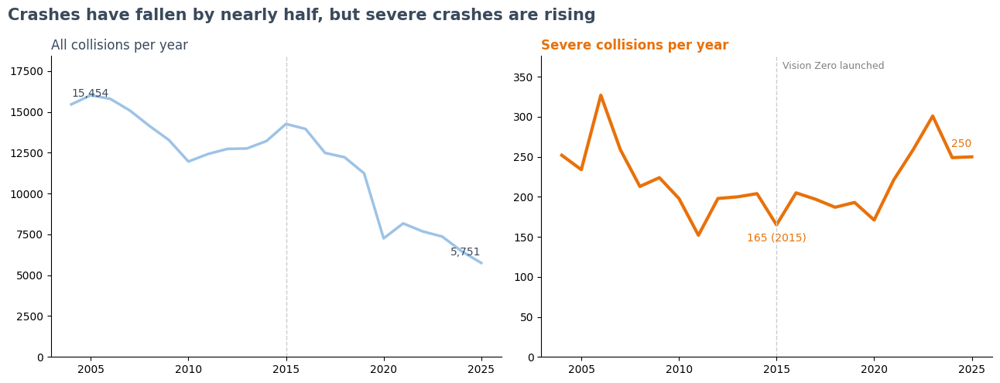
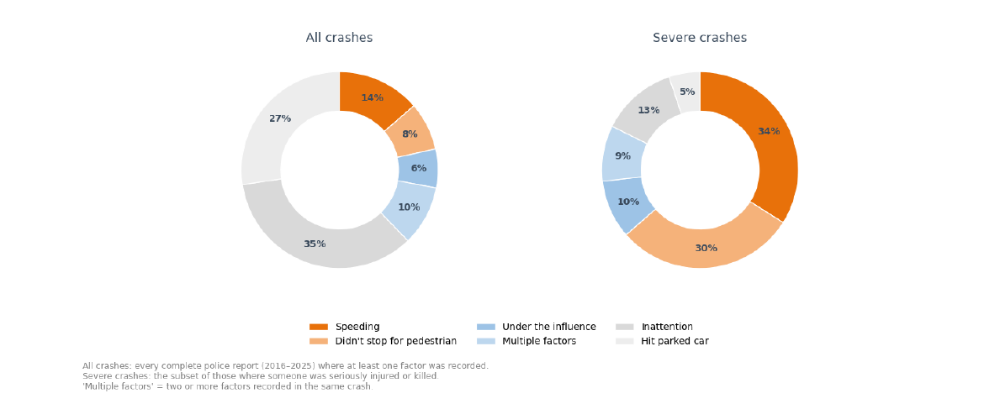
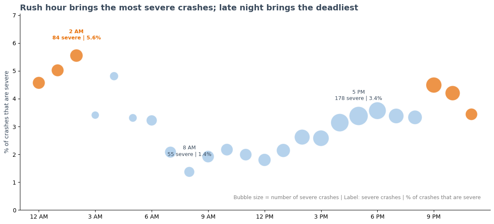
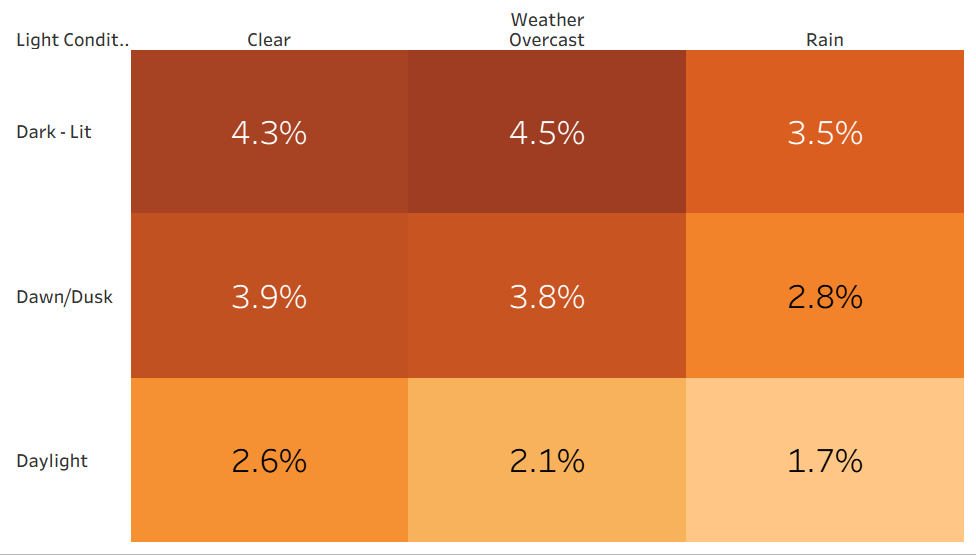
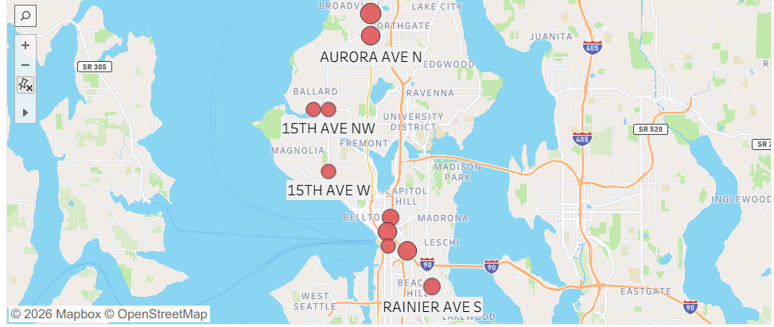

# Fewer Crashes, Deadlier Roads
### Where Seattle Should Act to Reach Vision Zero

A data story analyzing **262,000+ Seattle traffic collisions (2004–2025)** to help the Seattle Department of Transportation (SDOT) decide where, when, and on which driver behaviors to focus its limited safety budget.

**Tools:** Python (pandas, matplotlib) · Google Colab · Tableau Public
**Course:** IE 6600 Computation and Visualization, Northeastern University

---

## The Problem

In 2015, Seattle adopted **Vision Zero**, a goal to end traffic deaths and serious injuries by 2030. Total crashes have fallen since then, but the most serious crashes have not. With a limited budget, SDOT can't redesign every street or patrol every corridor, so this is a **prioritization problem**.

## Key Findings

| # | Business Question | Finding |
|---|---|---|
| 1 | Is Seattle on track for Vision Zero? | **No.** Total collisions fell ~44%, but severe collisions rose ~34% (5-year averages, 2010–14 vs 2021–25). |
| 2 | Which driver behaviors matter most? | **Speeding (34%) and not stopping for pedestrians (30%)** account for 64% of severe crashes. Speeding alone is in 54% of fatal crashes with a recorded factor. |
| 3 | When should enforcement focus? | The **evening rush (3–9 PM)** has the most severe crashes; **late night** has the highest risk per crash (5.6% severe at 2 AM vs 1.4% at 8 AM). |
| 4 | Bad weather or clear nights? | **Clear nights.** A crash on a clear night is ~2.5× as likely to be severe as one on a rainy day. |
| 5 | Where are pedestrians and cyclists hurt? | Pedestrians and cyclists are in <8% of crashes but **~49% of severe crashes**. **Aurora Ave N** holds two of the top four locations. |

### 1. Total crashes are falling, but severe crashes are rising


### 2. Speeding and failing to stop for pedestrians dominate severe crashes


### 3. Rush hour brings the most severe crashes; late night brings the deadliest


### 4. A crash on a clear night is 2.5x as likely to be severe as one on a rainy day


### 5. Pedestrians and cyclists are most often seriously hurt on Aurora Ave N


## Recommendations for SDOT

1. **Target speeding** with speed cameras, lower limits on high-risk arterials, and traffic-calming street design.
2. **Protect people walking and biking** at the highest-risk locations, starting with Aurora Ave N.
3. **Focus enforcement on two windows:** evening rush (3–9 PM) and late night (9 PM–3 AM).
4. **Shift campaign messaging** from "drive carefully in the rain" to "slow down on clear nights."
5. **Track severe crashes, not total crashes,** as the primary Vision Zero metric.

---

## Data

**Source:** [SDOT Collisions – All Years](https://catalog.data.gov/dataset/sdot-collisions-all-years) (City of Seattle, via Data.gov)
**Field definitions:** [SDOT Collisions metadata](https://www.seattle.gov/Documents/Departments/SDOT/GIS/Collisions_OD.pdf)

- Raw: 262,998 records × 64 columns (Oct 2003 – Oct 2026). Not included in this repo due to size; download from the link above.
- Cleaned: 262,615 records × 43 columns, included as `data/SDOT_Collisions_Clean.zip`.

### Cleaning steps
- Removed duplicate report numbers and rows with no severity
- Parsed dates/times into Year, Month, Day of Week, Hour; flagged rows with no recorded time instead of guessing
- Created a `Severe` flag (serious injury or fatal) to match the Vision Zero target
- Standardized behavior flags (blank = "not recorded," not "no")
- Grouped weather, road, and light values into reliable categories
- Converted Washington State Plane coordinates to latitude/longitude for mapping
- Dropped 21 internal or mostly empty fields

## Repository Structure

```
├── README.md
├── data/
│   └── SDOT_Collisions_Clean.zip      # cleaned dataset (unzip before use)
├── notebooks/
│   └── analysis.ipynb                 # cleaning, analysis, and Python charts (Google Colab)
├── tableau/
│   └── ShivaniMohan_DataStory.twb     # map and highlight table
├── reports/
│   ├── Project_Report_Data_Story.pdf
│   └── ShivaniMohan_Seattle_Collision_DataStory.pptx
├── visuals/                           # exported chart images
└── requirements.txt
```

## How to Reproduce

1. Install dependencies with `pip install -r requirements.txt` (or open the notebook in Google Colab, where they are preinstalled).
2. Unzip `data/SDOT_Collisions_Clean.zip` to use the cleaned data directly, or download the raw data and run `notebooks/analysis.ipynb` from the start.
3. To open the Tableau workbook, open `tableau/ShivaniMohan_DataStory.twb` in Tableau and point the data source to the unzipped `SDOT_Collisions_Clean.csv` when prompted.

## Limitations

- Behavior flags (speeding, impairment, inattention) are only recorded when an officer notes them, so they are likely undercounted. Findings show association, not causation.
- About 23% of crashes have no recorded time and about 20% have unknown conditions; these were excluded only where those fields were needed.
- No traffic-volume data, so results are crash counts and shares, not rates per vehicle or mile.
- The drop in total crashes after 2019 may partly reflect the pandemic and reporting changes.

**Next step:** a classification model to predict crash severity and a corridor-level risk model to rank safety projects by expected impact.

---

**Shivani Mohan** · [GitHub](https://github.com/ShivaniM29)
